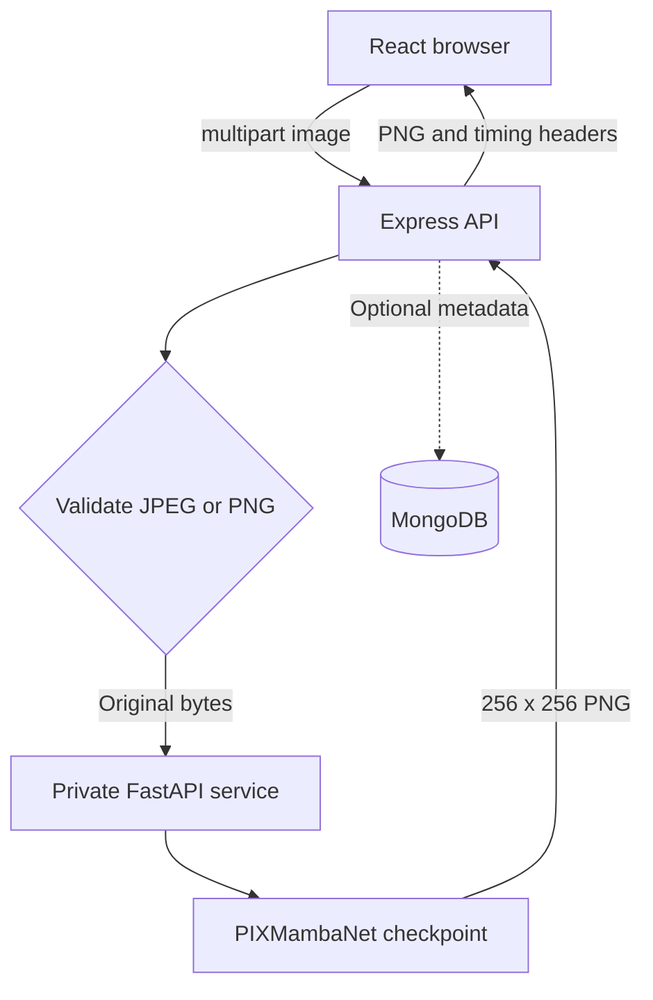

# Underwater Image Enhancement Using PIXMambaNet

A complete local MERN application with a private PyTorch inference service. React uploads to Express, Express validates and forwards original image bytes, and FastAPI runs **your supplied checkpoint**. Images enhance automatically after selection; no extra Enhance button.

## Included

- React + Vite + JavaScript + Tailwind CSS, Axios and Lucide icons.
- Responsive navy/cyan UI, drag-and-drop, sequential batches (up to 10), loading feedback, errors and retries.
- Before/after slider, side-by-side, fullscreen dialog, actual enhanced PNG downloads, last 10 results in browser memory.
- Node + Express, Multer, byte/format/dimension/decode validation, timeouts, CORS, rate limits and bounded concurrency.
- Optional MongoDB/Mongoose metadata history, independent of core enhancement.
- FastAPI/PyTorch service using the exact notebook classes and uploaded weights, loaded once at startup.
- Original notebook, model provenance and the original verification report.

## Architecture



Python is never called by the browser. Express returns binary PNG bytes, not a URL to an unrelated image. All model uploads are prohibited: the server loads only the bundled, fixed checkpoint. No paid API, training dataset or retraining is required.

## Windows + VS Code setup

Use three VS Code terminals, opened from the extracted `underwater-image-enhancement` folder. Commands below use PowerShell. Keep all three processes running.

### 1. Install prerequisites

1. Install **Node.js 24 LTS** from https://nodejs.org/en/download (Node 22.12+ also supports this Vite version). Keep npm enabled.
2. Install **Python 3.12, 64-bit** from https://www.python.org/downloads/windows/ and select “Add python.exe to PATH”. Python 3.11 is also suitable.
3. Install VS Code from https://code.visualstudio.com/download.
4. Extract the ZIP, then use **File → Open Folder** and select `underwater-image-enhancement`.
5. Open a new terminal and verify:

```powershell
node --version
npm --version
py -3.12 --version
```

If `py -3.12` is not available but your `python --version` shows Python 3.12, use `python` instead of `py -3.12` when creating the virtual environment.

### 2. Python inference service — Terminal 1

```powershell
cd ml-service
py -3.12 -m venv .venv
Copy-Item .env.example .env
.\.venv\Scripts\python.exe -m pip install --upgrade pip
.\.venv\Scripts\python.exe -m pip install torch torchvision --index-url https://download.pytorch.org/whl/cpu
.\.venv\Scripts\python.exe -m pip install -r requirements.txt
.\.venv\Scripts\python.exe -m uvicorn main:app --host 127.0.0.1 --port 8000 --workers 1
```

These commands use the virtual environment directly, so PowerShell activation/execution-policy changes are unnecessary. If you prefer activation, run `.\.venv\Scripts\Activate.ps1`, then use `python`.

The first install can take several minutes. Startup fails if the checkpoint is absent or mismatched; there is no fake-output fallback. Expect “Application startup complete”. The model is included at `ml-service/model/underwater_image_enhancement.pth`.

For an NVIDIA GPU, replace the CPU-specific installation command with the matching Windows/Pip/CUDA command from https://pytorch.org/get-started/locally/. Choose a compatible torch/torchvision pair from that selector and install them in this same virtual environment. The service automatically uses CUDA if `torch.cuda.is_available()` is true. CPU is supported; Apple MPS is not selected by this project because the requested device logic is CUDA/CPU.

### 3. Express backend — Terminal 2

Start from the project root:

```powershell
cd server
Copy-Item .env.example .env
npm ci
npm run dev
```

Expect `Express ready at http://127.0.0.1:5000`.

For a first run leave `HISTORY_ENABLED=false`. Keep `ML_SERVICE_URL=http://127.0.0.1:8000`. The `INFERENCE_API_KEY` values in `server/.env` and `ml-service/.env` must match. The supplied value is for local development; set your own matching random value for any deployment. Restart both services after changing it.

### 4. React frontend — Terminal 3

Start from the project root:

```powershell
cd client
Copy-Item .env.example .env
npm ci
npm run dev
```

Open **http://localhost:5173**. Vite proxies `/api` to Express. Leave `VITE_API_BASE_URL` empty. No Python address or private key belongs in the frontend.

### 5. Test with an underwater image

1. Wait for **Model ready**. If offline, check both backend terminals and press the status badge to retry.
2. Drag a JPEG/PNG into the uploader, or choose **Browse images**. Maximum 10 MB and 20 million pixels per image; animated images are rejected.
3. Enhancement starts immediately. Selecting several files processes them one at a time.
4. Drag the comparison divider, or switch to side-by-side. The original is visually stretched to match the square model input; the source bytes sent to Python are unchanged.
5. Open fullscreen or select **Download enhanced image**. The downloaded file is the actual 256 × 256 model PNG.
6. Select a recent result to compare it again. **Clear** removes browser-memory results and frees object URLs; it does not delete MongoDB metadata.

Results are not upscaled. Enlarging the preview does not recover detail lost during the notebook's 256 × 256 resize. Color/clarity improvements depend on the supplied trained model. There is no guaranteed runtime or quality score.

## Optional MongoDB history

Core enhancement works with history disabled or disconnected. MongoDB stores metadata only: filename, dimensions, byte sizes, timestamp, inference/API timings and `outputStored:false`. PNGs are not persisted to disk or MongoDB; downloads remain available while held by the current page.

### Local MongoDB Community

1. Install MongoDB Community Server for Windows from https://www.mongodb.com/try/download/community; choose installation as a Windows service.
2. Start the MongoDB service from Windows Services if it is not already running.
3. In `server/.env`, set:

```dotenv
HISTORY_ENABLED=true
MONGODB_URI=mongodb://127.0.0.1:27017/pixmamba
```

4. Restart Express. Expect `MongoDB history connected`.

### MongoDB Atlas alternative

1. Create a cluster at https://www.mongodb.com/atlas/database (a free offering can be used where available).
2. Create a database user and allow your own client IP in the Atlas network access settings.
3. Copy the driver connection string, insert your credentials and a database name, and put it in `server/.env` as `MONGODB_URI`. URL-encode special characters in the password.
4. Set `HISTORY_ENABLED=true` and restart Express. Never put database credentials in `client/.env` or commit `.env` files.

History is scoped by a cryptographically random per-tab session ID stored in sessionStorage. This is a local-demo privacy boundary, **not user authentication**. A new browser session will not show other sessions' records. The latest 20 matching records are returned; MongoDB TTL removes records after roughly 7 days (TTL cleanup is asynchronous). Metadata saves are best effort and the frontend refreshes them every 30 seconds. MongoDB disconnects do not block enhancement.

## Production build on your machine

Build React:

```powershell
cd client
npm run build
```

Set `SERVE_CLIENT=true` in `server/.env`, then run `npm start` from `server`. Keep the Python service running. Open **http://127.0.0.1:5000**; Express serves the compiled frontend and API from the same origin. Vite is not needed in this mode.

For a hosted deployment, run Express behind HTTPS, configure `CLIENT_ORIGIN` to your exact UI origin, and keep Python reachable only on a private network/loopback with a strong matching service key. Set `HOST` appropriately only behind that perimeter. Use one Python worker to avoid duplicate model loads. Do not publish port 8000 or put it in browser code. If scaling beyond one server, add a shared admission/queue policy and decide on authentication for a multi-user deployment. This deliverable is a complete local project with production-style controls, not a claim of a hosted or penetration-tested production system.

## Configuration

| File / variable | Default | Purpose |
|---|---|---|
| `server/.env` `PORT`, `HOST` | `5000`, `127.0.0.1` | Local Express binding |
| `CLIENT_ORIGIN` | localhost/127.0.0.1 on 5173 | Comma-separated exact allowed browser origins |
| `ML_SERVICE_URL` | `http://127.0.0.1:8000` | Private backend-only service URL |
| `INFERENCE_API_KEY` | development value | Must match Python; never exposed to React |
| `ML_TIMEOUT_MS` | `120000` | Express inference request timeout |
| `MAX_UPLOAD_MB` | `10` | Server byte limit; match Python and client if changed |
| `HISTORY_ENABLED` | `false` | Optional metadata persistence |
| `MONGODB_URI` | local database | MongoDB connection |
| `SERVE_CLIENT` | `false` | Serve `client/dist` through Express |
| `ml-service/.env` `MODEL_PATH` | bundled weights | Fixed trusted checkpoint path |
| `TORCH_NUM_THREADS` | `2` | CPU inference threads; tune on your machine |
| `client/.env` `VITE_API_BASE_URL` | empty | Same-origin API by default |

The `terminal.local` Vite allowed host is included for the development preview used during verification. It is not a deployment address.

## APIs

| Endpoint | Contract |
|---|---|
| `GET /api/health` | 200 when model is ready, 503 if inference service is unavailable; includes history status |
| `POST /api/enhance` | One multipart field named `image`; returns binary `image/png` |
| `GET /api/history` | Latest metadata for `X-Session-Id`; returns empty items and availability reason if disabled/unavailable |
| Private `GET /health` | Model loading/device/tensor count |
| Private `POST /predict` | Raw JPEG/PNG bytes and `X-Inference-Key`; returns actual PNG |

Image responses include `X-Inference-Time-Ms`, `X-Processing-Time-Ms`, `X-Output-Width`, `X-Output-Height` and `X-History-Status`. API time starts before upload validation and ends just before response delivery; it excludes the browser download and asynchronous history write. Model time covers the model forward pass with CUDA synchronization when applicable; resize/encoding and transfer overhead are excluded.

Errors: 400 missing/invalid multipart; 413 too large; 415 unsupported or mislabeled format; 422 malformed/too many pixels; 429 rate limit; 503 busy/model unavailable on health; 502 unavailable upstream on enhancement; 504 inference timeout. Python also returns 401 for an invalid internal key. Express intentionally does not expose private upstream error details. One active request per Express process and one inference per Python process bound memory; other callers receive a retryable busy response. The UI serializes its own batch.

## Package contents

This edition excludes automated tests, test scripts and testing dependencies. The app, trained checkpoint and setup instructions are included. `docs/VERIFICATION.md` records verification performed on the original development edition; its test commands are not included in this package.

## Model provenance

See `docs/MODEL_PROVENANCE.md`. The source notebook is included unchanged as `docs/original_notebook.ipynb`. Training code is not executed. Both model classes are extracted verbatim from notebook cells 16 and 18 (zero-based), and their ASTs were compared against the notebook during original verification.

Checkpoint SHA-256:

```text
eec5fbdd4947fcdf0d360bf4b661881218676d2b29ab8e1911fd3ff3ed9b3861
```

32 tensors match with `strict=True`. The final sigmoid is followed by the notebook's `ToPILImage()` conversion without added enhancement filters, normalization, sharpening or original-size upscaling.

## Troubleshooting

- **Model offline:** start Python first; inspect `http://127.0.0.1:8000/health`, then `http://127.0.0.1:5000/api/health`. Check the fixed model path and matching internal keys.
- **Port already used:** close the prior process with Ctrl+C. If changing ports, update the Vite proxy/ML URL as needed.
- **Torch/torchvision import error:** install a matching pair using the official PyTorch selector in the same virtual environment; do not mix unrelated releases.
- **MongoDB unavailable:** keep using enhancement; verify the URI, Windows service or Atlas IP access. Initial connection retries every 30 seconds; the driver handles later reconnects.
- **CORS error:** use the documented localhost URL, or add your exact frontend origin to `CLIENT_ORIGIN` and restart Express.
- **Image looks stretched:** the original notebook resizes to 256 × 256. This implementation preserves that behavior.
- **Busy response:** wait for the other request to finish and select the image again. Batches within one page are already serialized.
- **Timeout:** verify CPU/GPU setup; adjust backend and frontend timeouts together if your device needs more time.
- **Downloads disappear after refresh:** images live in browser memory only. Download them before leaving; MongoDB history stores metadata, not files.

## Official references

- Vite setup and Node requirements: https://vite.dev/guide/
- PyTorch saving/loading: https://docs.pytorch.org/tutorials/beginner/saving_loading_models
- Torch installation: https://pytorch.org/get-started/locally/
